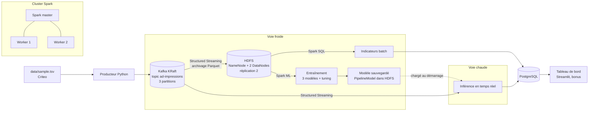

# AdClick Intelligence – Couches d'ingestion et de stockage

Projet « Pipeline Big Data de bout en bout » (modules Big Data Plateformes et Big Data Analytics) réalisé par **Souhaila ELMOUJIBI** et **Hajar AITLAKSSIR**.

Objectif du projet : prédire le clic sur une publicité (classification binaire) à partir du dataset **Criteo Display Advertising Challenge**.

> **Périmètre actuel : couche d'ingestion + couche de stockage.**
> - **Ingestion** : un broker **Kafka** et un **producteur Python** qui rejoue un échantillon du dataset sous forme d'événements.
> - **Stockage (voie froide)** : un cluster **HDFS** (1 NameNode, 2 DataNodes, réplication 2), un cluster **Spark** (1 master, 2 workers) et un job **Spark Structured Streaming** qui archive Kafka dans HDFS en **Parquet**, puis un job batch qui relit cet historique et calcule les premiers indicateurs.
>
> Restent à faire : entraînement Spark ML, inférence en streaming (voie chaude), base de restitution PostgreSQL et tableau de bord.
>
> **Les démonstrations ont été faites sur des données FICTIVES** générées au format Criteo (`scripts/generate_fake_sample.py`). Le vrai dataset Criteo sera utilisé pour le ML, après validation du sujet et des données par l'enseignant. Les statistiques affichées avec les données fictives (nombre de clics, taux de clic...) ne sont donc pas des résultats.

## 1. Architecture globale du pipeline (cible)

Le pipeline suit les quatre couches demandées : ingestion, stockage (voie froide), streaming (voie chaude) et restitution, avec Spark SQL, Spark Structured Streaming et Spark ML pour l'analytique. **Les couches d'ingestion (Kafka + producteur) et de stockage (HDFS + Spark + archivage) sont implémentées** ; les autres composants sont conçus et seront ajoutés dans les livrables suivants.



Tous les traitements Spark (archivage, indicateurs, entraînement, inférence) sont soumis au cluster Spark (1 master et 2 workers). Les jobs en streaming utilisent des checkpoints stockés dans HDFS pour permettre la reprise après arrêt.

| Couche | Composant | Rôle | Image / version | État |
|---|---|---|---|---|
| Ingestion | `kafka` | Broker en mode KRaft (sans Zookeeper) | `apache/kafka:3.7.0` | **Implémenté** |
| Ingestion | `kafka-init` | Crée le topic `ad-impressions` (3 partitions) | `apache/kafka:3.7.0` | **Implémenté** |
| Ingestion | `producer` | Rejoue le fichier Criteo en événements JSON | Python 3.11, `kafka-python==2.0.2` | **Implémenté** |
| Ingestion | `consumer-check` | Relit le topic pour vérifier l'ingestion | Python 3.11 | **Implémenté** |
| Stockage | `namenode` | Métadonnées HDFS | `bde2020/hadoop-namenode:2.0.0-hadoop3.2.1-java8` (Hadoop 3.2.1) | **Implémenté** |
| Stockage | `datanode1`, `datanode2` | Blocs HDFS, réplication 2, deux volumes distincts | `bde2020/hadoop-datanode:2.0.0-hadoop3.2.1-java8` | **Implémenté** |
| Stockage | `hdfs-init` | Attend les 2 DataNodes, crée `/data`, `/checkpoints`, `/models`, `/indicators` | image NameNode | **Implémenté** |
| Traitement | `spark-master` | Ordonnanceur du cluster Spark | `apache/spark:3.5.6` + connecteur Kafka (`infra/spark`) | **Implémenté** |
| Traitement | `spark-worker-1`, `spark-worker-2` | Exécution des jobs Spark | même image | **Implémenté** |
| Stockage | `archiver` | Job Structured Streaming Kafka → HDFS (Parquet) | PySpark (`streaming/kafka_to_hdfs.py`) | **Implémenté** |
| Stockage | `spark-job` | Jobs batch à la demande (indicateurs) | PySpark (`batch/indicators.py`) | **Implémenté** |
| Traitement | jobs ML et inférence | Entraînement, voie chaude | PySpark | Prévu |
| Restitution | `postgres` | Prédictions et indicateurs batch | PostgreSQL 16 | Prévu |
| Restitution | `dashboard` | Affichage avec actualisation automatique (bonus) | Streamlit | Prévu |

Les versions des composants prévus (PostgreSQL, Streamlit) seront fixées dans le `docker-compose.yml` des livrables suivants.

## 2. Détail de la couche d'ingestion (implémentée)

```
data/sample.tsv ──► producer.py ──► Kafka (topic ad-impressions, 3 partitions) ──► consommateurs
 (échantillon          (JSON, 1 événement          KRaft, sans Zookeeper           (check_topic.py ici ;
  Criteo)               par impression)                                             Spark Structured Streaming ensuite)
```

| Service | Image | Rôle |
|---|---|---|
| `kafka` | `apache/kafka:3.7.0` | Broker en mode KRaft (broker + contrôleur) |
| `kafka-init` | `apache/kafka:3.7.0` | Crée le topic `ad-impressions` (3 partitions) puis s'arrête |
| `producer` | build `./ingestion` (Python 3.11) | Rejoue le fichier TSV vers Kafka (profil `tools`) |
| `consumer-check` | build `./ingestion` | Lit le topic pour vérifier le contenu (profil `tools`) |

## 3. Détail de la couche de stockage (implémentée)

```
Kafka (ad-impressions, 3 partitions)
   │  Spark Structured Streaming (job « archiver », sur le cluster Spark)
   ▼
HDFS : /data/impressions (Parquet, réplication 2)  ──►  Spark SQL (batch/indicators.py)  ──►  /indicators (Parquet)
   │                       │
   │                       └─ blocs répartis sur datanode1 et datanode2 (volumes distincts)
   └─ /checkpoints/archiver : offsets Kafka déjà archivés (reprise après arrêt)
```

| Élément | Choix |
|---|---|
| Format d'archivage | **Parquet** (colonnes typées : `label` int, `I1..I13` int, `C1..C26` string, `event_id` long, `event_time` timestamp) + métadonnées Kafka (`kafka_partition`, `kafka_offset`, `kafka_timestamp`) |
| Réplication HDFS | **2** (`HDFS_CONF_dfs_replication` dans `infra/hadoop/hadoop.env`, et `spark.hadoop.dfs.replication=2` côté clients Spark) |
| Volumes persistants | `namenode-data`, `datanode1-data`, `datanode2-data` (un volume par DataNode) et `kafka-data` |
| Cluster Spark | 1 master + 2 workers (2 cœurs et 1 Go chacun, soit 4 cœurs ; `archiver` n'en garde qu'1, les 3 autres restent disponibles pour les jobs batch, ML et streaming). Tous les jobs sont soumis avec `spark-submit --master spark://spark-master:7077` (script `infra/spark/submit.sh`) |
| Micro-lots | un lot toutes les 30 s, 100 000 messages maximum par lot (`--trigger-seconds`, `--max-offsets`) |
| Reprise | `checkpointLocation` dans HDFS : le job relancé reprend aux offsets Kafka mémorisés |
| Garantie | Écriture **exactement une fois** vers HDFS : source Kafka rejouable + checkpoint + journal des fichiers du sink Parquet de Spark. Un doublon n'apparaît que si le producteur renvoie les mêmes lignes ; il se détecte avec `event_id` (`rows` ≠ `distinct_events` dans `summary`) |

Indicateurs batch calculés par `batch/indicators.py` : `summary` (volume, doublons, clics, taux de clic), `by_partition`, `missing` (taux de valeurs manquantes par colonne), `numeric_stats` (moyenne, min, max des `I*`), `ctr_by_c1` (taux de clic par valeur de `C1`).

### Concepts HDFS et Spark utilisés

- **NameNode** : garde les métadonnées (quel fichier = quels blocs, sur quels DataNodes). Il ne stocke pas les données.
- **DataNode** : stocke les blocs (128 Mo par défaut) et envoie un heartbeat au NameNode toutes les 3 secondes.
- **Réplication 2** : chaque bloc existe sur les 2 DataNodes ; la perte d'un DataNode ne perd aucune donnée.
- **Parquet** : format en colonnes, compressé, rapide à lire pour l'analyse.
- **Structured Streaming** : traite le flux Kafka par micro-lots et écrit en HDFS ; le **checkpoint** permet la reprise sans perte.
- **Cluster Spark** : le master répartit les tâches entre les workers ; les 3 partitions Kafka sont lues en parallèle par les tâches.

## 4. Données

- Source : Criteo Display Advertising Challenge (Kaggle / Criteo AI Lab).
- **Conditions d'utilisation** : dataset destiné à la recherche et à un usage **non commercial** (licence indiquée par Criteo : CC BY-NC-SA 3.0 ; à reconfirmer sur la page officielle du dataset et à citer dans le rapport). Notre usage est strictement pédagogique.
- Fichier d'origine `train.txt` : TSV, colonne 1 = `label` (1 = clic), colonnes 2–14 = `I1…I13` (numériques, valeurs manquantes), colonnes 15–40 = `C1…C26` (catégorielles hachées et anonymisées).
- Volume : environ 45 millions de lignes (≈ 11 Go). Nous travaillerons sur un **échantillon** (les 2 000 000 premières lignes) pour tenir sur des machines d'étudiants.
- Sens d'un événement : une impression publicitaire affichée à un internaute ; `label` indique s'il a cliqué.
- Le fichier d'origine n'a **ni identifiant ni horodatage** : le producteur ajoute `event_id` (numéro de ligne) et `event_time` (heure d'envoi). Ces deux champs sont **simulés**.
- Variables explicatives : `I1…I13` et `C1…C26`, toutes disponibles au moment de la prédiction. Cible : `label`.
- Pour la démonstration actuelle : faux échantillon (`generate_fake_sample.py`), **à ne jamais utiliser pour les résultats du projet**.

### Format d'un événement (JSON)

```json
{"label": "0", "I1": "1", "I2": null, "...": "...", "C1": "68fd1e64", "C2": "80e26c9b", "...": "...",
 "event_id": 12, "event_time": 1762358400.123}
```

Les valeurs manquantes sont envoyées à `null`. Les champs `I*` et `label` sont des chaînes à ce stade : le typage est fait côté Spark.

## 5. Prérequis

- Docker Desktop (ou Docker Engine) avec Docker Compose v2. Sous Windows, Docker Desktop avec WSL2.
- Ressources : **au moins 8 Go de RAM alloués à Docker** (Docker Desktop → Settings → Resources) pour Kafka + HDFS + Spark ; environ **8 Go de disque** pour les images (Hadoop, Spark, Kafka) et les volumes.
- Accès Internet au premier lancement (téléchargement des images et du connecteur Kafka de Spark).
- Ports libres sur la machine : 29092 (Kafka), 9870 (NameNode), 9864 et 9865 (DataNodes), 8080 (Spark master), 8081 et 8082 (workers), 4040 (job d'archivage).
- Python 3.11 (ou `py` sous Windows) pour générer le faux échantillon.
- Pour les vraies données : le fichier `train.txt` de Criteo (non fourni dans ce dépôt).

## 6. Lancement pas à pas

### Linux / macOS / Git Bash / WSL

```bash
# 1. Variables d'environnement
cp .env.example .env

# 2. Échantillon
python scripts/generate_fake_sample.py 100000 data/sample.tsv    # DONNÉES FICTIVES (test)
#    ou, avec le vrai dataset :
scripts/make_sample.sh /chemin/vers/train.txt 2000000
```

### Windows (PowerShell)

```powershell
copy .env.example .env
python scripts\generate_fake_sample.py 100000 data\sample.tsv    # DONNÉES FICTIVES (test)
# vrai dataset :
python -c "import itertools; open('data/sample.tsv','w',encoding='utf-8',newline='\n').writelines(itertools.islice(open(r'C:\chemin\train.txt',encoding='utf-8'),2000000))"
```

Vérifier que `data/sample.tsv` n'est pas vide (`dir data` : taille supérieure à 0).

### Démarrage de Kafka et test (toutes plateformes)

```bash
# 3. Démarrer Kafka et créer le topic
docker compose up -d kafka kafka-init
docker compose logs kafka-init          # DOIT afficher « PartitionCount: 3 »

# 4. Publier des événements (ex. 20 000 lignes à 500 msg/s)
docker compose run --rm producer producer.py --rate 500 --end 20000

# 5. Vérifier ce qui est dans Kafka
docker compose run --rm consumer-check check_topic.py --show 3 --group test1 --timeout 20
```

Résultat attendu à l'étape 5 : `Total lu : 20000 | par partition : {0: ~6700, 1: ~6700, 2: ~6700} | clics (label=1) : ...`.

### Pièges connus

- **Vérifiez `PartitionCount: 3` avant de lancer le producteur ou un consommateur.** Si un client se connecte avant que `kafka-init` ait créé le topic, Kafka le crée automatiquement avec **1 seule partition** (tous les messages arrivent alors dans la partition 0). Correction :
  ```bash
  docker compose exec kafka /opt/kafka/bin/kafka-topics.sh --bootstrap-server kafka:9092 --delete --topic ad-impressions
  docker compose up kafka-init
  ```
- Un consommateur reprend là où son groupe s'est arrêté : pour relire le topic depuis le début, utilisez un **nouveau nom de groupe** (`--group test2`, etc.). Sinon il affiche `Total lu : 0`.
- Si `data/sample.tsv` est vide (0 octet), le producteur n'envoie rien : régénérez le fichier.

### Couche de stockage : HDFS, Spark et archivage (toutes plateformes)

Les commandes sont identiques sous PowerShell, Git Bash et Linux. Prérequis : l'ingestion fonctionne (étapes 3 à 5 ci-dessus) et `data/sample.tsv` contient 100 000 lignes.

```bash
# 6. Démarrer HDFS et le cluster Spark
#    (1er lancement : téléchargement des images et construction de l'image Spark, plusieurs minutes)
docker compose build spark-master        # construit l'image Spark UNE SEULE FOIS (évite une construction en parallèle)
docker compose up -d namenode datanode1 datanode2 hdfs-init spark-master spark-worker-1 spark-worker-2
docker compose logs hdfs-init            # doit finir par « HDFS prêt : 2 DataNodes, réplication 2 »

# 7. Vérifier le cluster
docker compose exec namenode hdfs dfsadmin -report     # « Live datanodes (2) »
#    Interfaces : http://localhost:9870 (onglet Datanodes : 2 nœuds)  http://localhost:8080 (2 workers ALIVE)

# 8. Constituer l'historique : publier les 80 000 premières lignes dans Kafka (vitesse maximale)
docker compose run --rm producer producer.py --rate 0 --end 80000

# 9. Lancer l'archivage Kafka -> HDFS (job permanent, démarre aussi Kafka et crée le topic si besoin)
docker compose up -d archiver
docker compose logs archiver             # attendre « Archivage démarré » (Ctrl+C pour quitter les logs)

# 10. Vérifier l'historique dans HDFS (compter ~1 minute : un lot toutes les 30 s)
docker compose exec namenode hdfs dfs -ls /data/impressions
docker compose exec namenode hdfs fsck /data/impressions -files -blocks -locations
#    fsck doit afficher « Default replication factor: 2 », « Average block replication: 2.0 » et 0 « Under-replicated blocks »

# 11. Relire l'historique avec Spark et calculer les indicateurs batch
docker compose run --rm spark-job /app/batch/indicators.py
#    summary : rows = 80000 et distinct_events = 80000 (aucun doublon)
```

**Test de reprise (aperçu)** : arrêter le job, publier des événements pendant l'arrêt, relancer, puis vérifier qu'aucun événement n'est perdu ni dupliqué.

```bash
docker compose stop archiver
docker compose run --rm producer producer.py --rate 0 --start 80000 --end 90000
docker compose start archiver
#    après ~1 minute : relancer l'étape 11 ; attendu : rows = distinct_events = 90000
```

**Test unitaire local de la logique Spark** (sans Docker ni Kafka) : `pip install pyspark==3.5.6 pytest` puis `python -m pytest tests -q`.

### Pièges connus du stockage

- **Ne remettre à zéro qu'un seul côté (Kafka ou HDFS) rend le checkpoint incohérent** : le job échoue en signalant que des offsets Kafka ont changé. Pour repartir proprement, tout effacer ensemble : `docker compose down -v` (voir ci-dessous).
- Si `hdfs-init` affiche longtemps « attente des 2 DataNodes... », consulter `docker compose logs datanode1 datanode2`.
- Relancer le producteur sur les mêmes lignes crée des **doublons** dans l'archive (mêmes `event_id`) : `rows` devient supérieur à `distinct_events` dans `summary`.
- Si un port est déjà utilisé (par exemple 8080), modifier le mapping de ports dans `docker-compose.yml` (ex. `"8088:8080"`).
- Les images Hadoop utilisées (`bde2020`) sont anciennes (Hadoop 3.2.1) mais très répandues ; elles sont compatibles avec le client Hadoop de Spark 3.5.

Options du producteur : `--rate` (messages/s, 0 = vitesse max), `--start` / `--end` (plage de lignes), `--topic`, `--dry-run` (affiche le JSON sans Kafka).

Découpage prévu pour la suite : lignes 0 → 1 600 000 pour constituer l'historique (envoi rapide), lignes 1 600 000 → 2 000 000 pour la démonstration en direct (20 à 50 msg/s).

### Observer plusieurs consommateurs

```bash
# Même groupe dans deux terminaux : les 3 partitions se répartissent entre les deux consommateurs
docker compose run --rm consumer-check check_topic.py --group g1
# Groupe différent : il reçoit tous les messages indépendamment
docker compose run --rm consumer-check check_topic.py --group g2
```

Depuis la machine hôte, Kafka est joignable sur `localhost:29092`.

### Arrêt et nettoyage

```bash
docker compose stop        # met tout en pause, conserve les conteneurs et les données
docker compose down        # supprime les conteneurs, CONSERVE les volumes (Kafka, HDFS, checkpoints) : état cohérent
docker compose down -v     # remise à zéro COMPLÈTE : supprime aussi Kafka, HDFS et les checkpoints
```

## 7. Concepts Kafka utilisés

- **Topic** : flux nommé d'événements (`ad-impressions`), divisé en **partitions** (3) pour le parallélisme.
- **Clé** : le producteur utilise `event_id` comme clé, ce qui répartit les messages entre les partitions.
- **Producteurs / consommateurs multiples** : plusieurs producteurs peuvent écrire dans le même topic ; plusieurs consommateurs peuvent lire, soit en se partageant les partitions (même groupe), soit chacun l'intégralité (groupes différents). C'est ce qui permettra à Spark (archivage et inférence) de lire le même flux indépendamment.
- **Garanties** : `acks=all` côté producteur ; un seul broker ici (facteur de réplication 1), ce qui est suffisant pour un cluster simulé.

## 8. Structure du dépôt

```
ingestion/   producer.py, check_topic.py, Dockerfile        streaming/  kafka_to_hdfs.py (archivage Kafka -> HDFS)
batch/       indicators.py (analyse de l'historique)         infra/      hadoop/hadoop.env, spark/Dockerfile, spark/submit.sh
scripts/     échantillon (fictif ou réel)                    tests/      test_storage_logic.py (Spark local)
data/        non versionné                                   docs/       rapport, contributions, captures
docker-compose.yml   .env.example   .gitattributes   README.md
```

## 9. Limites connues et suite

- `event_id` et `event_time` sont simulés ; `event_time` représente l'heure du rejeu, pas celle de l'impression réelle. Pour le découpage temporel train/test, l'ordre de `event_id` fera foi.
- Les doublons causés par un renvoi des mêmes lignes par le producteur ne sont pas filtrés à l'archivage ; la déduplication par `event_id` sera faite avant l'entraînement.
- Un micro-lot toutes les 30 s produit de petits fichiers Parquet ; un compactage pourra être ajouté.
- Un seul NameNode (pas de haute disponibilité) : acceptable pour un cluster simulé.
- Les couches ont été validées sur données fictives ; le sujet et le dataset restent à faire valider par l'enseignant.
- Prochaines étapes : entraînement Spark ML (comparaison de 3 techniques, tuning, modèle sauvegardé dans HDFS), inférence en streaming, PostgreSQL, tableau de bord, test complet de reprise, rapport et vidéo.

## 10. Contributions

- Souhaila ELMOUJIBI
- Hajar AITLAKSSIR
